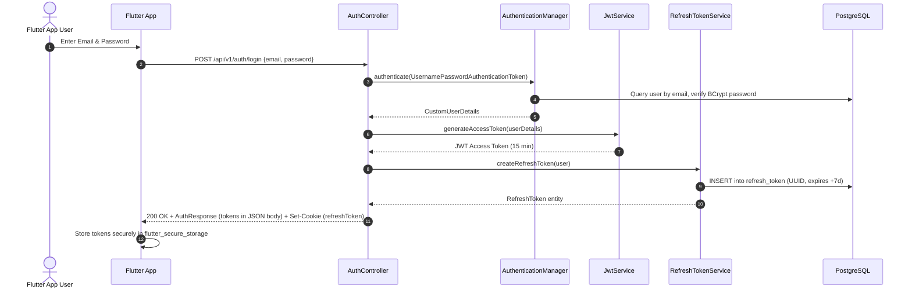

# Phase 2: Authentication & Authorization Specification

This document details the authentication and authorization implementation in the Spring Boot backend, evaluating its readiness and design requirements for a Flutter mobile client.

---

## 1. Authentication Architecture Overview

The system uses a hybrid model:
1. **Stateless JWT Access Token**: Issued on login and refresh, validated via an HTTP `Authorization: Bearer <token>` header on each request.
2. **Database-backed Refresh Token**: Stored in PostgreSQL table `refresh_token`, linked to a user with an expiration timestamp.



---

## 2. Authentication Endpoints

### 2.1 Login

- **Endpoint**: `POST /api/v1/auth/login`
- **Controller**: [AuthController.java](file:///D:/Course Wing/Final/fix/helpdesk/src/main/java/com/zaby/helpdesk/controller/AuthController.java#L24)
- **Service**: [AuthServiceImpl.java](file:///D:/Course Wing/Final/fix/helpdesk/src/main/java/com/zaby/helpdesk/service/impl/AuthServiceImpl.java#L26)
- **Auth Required**: **None** (Publicly accessible via `.requestMatchers("/api/v1/auth/**").permitAll()`)
- **Request Headers**: `Content-Type: application/json`
- **Request Body** ([LoginRequest.java](file:///D:/Course Wing/Final/fix/helpdesk/src/main/java/com/zaby/helpdesk/dto/request/LoginRequest.java)):
  ```json
  {
    "email": "admin1@helpdesk.com",
    "password": "password"
  }
  ```
- **Response Status**: `200 OK`
- **Response Body** ([AuthResponse.java](file:///D:/Course Wing/Final/fix/helpdesk/src/main/java/com/zaby/helpdesk/dto/response/AuthResponse.java)):
  ```json
  {
    "email": "admin1@helpdesk.com",
    "message": "Login successful",
    "firstName": "Admin",
    "lastName": "User",
    "departmentId": 1,
    "role": "ADMIN",
    "accessToken": "eyJhbGciOiJIUzI1NiJ9...",
    "refreshToken": "4a71392b-8a8b-4c48-b4b9-1e35fafe24f1"
  }
  ```
- **Response Headers**: Sets an HTTP-only cookie:
  ```http
  Set-Cookie: refreshToken=4a71392b-8a8b-4c48-b4b9-1e35fafe24f1; Max-Age=604800; Expires=...; Path=/; HttpOnly
  ```

### 2.2 Token Refresh

- **Endpoint**: `POST /api/v1/auth/refresh`
- **Controller**: [AuthController.java](file:///D:/Course Wing/Final/fix/helpdesk/src/main/java/com/zaby/helpdesk/controller/AuthController.java#L30)
- **Auth Required**: **None** (Permitted in security configuration; authenticates via refresh token)
- **Request Body** ([RefreshTokenRequest.java](file:///D:/Course Wing/Final/fix/helpdesk/src/main/java/com/zaby/helpdesk/dto/request/RefreshTokenRequest.java)):
  ```json
  {
    "refreshToken": "4a71392b-8a8b-4c48-b4b9-1e35fafe24f1"
  }
  ```
- **Validation Logic**:
  1. If `request == null || request.refreshToken() == null`, returns `401 Unauthorized`.
  2. Looks up token in table `refresh_token` via [RefreshTokenRepository.java](file:///D:/Course Wing/Final/fix/helpdesk/src/main/java/com/zaby/helpdesk/repository/RefreshTokenRepository.java).
  3. If token does not exist or `LocalDateTime.now().isAfter(expiresDate)`, returns `401 Unauthorized`.
  4. Generates a new JWT access token (15-minute expiry).
  5. Returns `AuthResponse` with the newly minted access token and the same refresh token.
- **Response Status**: `200 OK`
- **Response Body**:
  ```json
  {
    "email": "admin1@helpdesk.com",
    "message": "Token refreshed",
    "firstName": "Admin",
    "lastName": "User",
    "departmentId": 1,
    "role": "ADMIN",
    "accessToken": "eyJhbGciOiJIUzI1NiJ9...",
    "refreshToken": "4a71392b-8a8b-4c48-b4b9-1e35fafe24f1"
  }
  ```

> [!WARNING]
> **NPE Bug in Refresh Endpoint**: In [AuthController.java](file:///D:/Course Wing/Final/fix/helpdesk/src/main/java/com/zaby/helpdesk/controller/AuthController.java#L52), line 52 executes:
> `tokenEntity.getUser().getDepartment().getId()`
> If a user is created without an assigned department (`user.department == null`), refreshing their token triggers an uncaught `NullPointerException`, resulting in an HTTP 500 error instead of a valid token refresh!

### 2.3 Logout

- **Endpoint**: `POST /api/v1/auth/logout`
- **Controller**: [AuthController.java](file:///D:/Course Wing/Final/fix/helpdesk/src/main/java/com/zaby/helpdesk/controller/AuthController.java#L59)
- **Auth Required**: **None** (Publicly accessible)
- **Request Body**:
  ```json
  {
    "refreshToken": "4a71392b-8a8b-4c48-b4b9-1e35fafe24f1"
  }
  ```
- **Behavior**: Deletes the token entry from `refresh_token` table using [RefreshTokenRepository.deleteByToken](file:///D:/Course Wing/Final/fix/helpdesk/src/main/java/com/zaby/helpdesk/repository/RefreshTokenRepository.java#L12).
- **Response Status**: `200 OK` with an empty response body.

---

## 3. Account Lifecycle & Missing Flows

The backend lacks essential self-service account management endpoints:

| Flow | Status in Backend | Source Inspection | Mobile Impact |
| :--- | :--- | :--- | :--- |
| **User Self-Registration** | **MISSING** | [AuthController.java](file:///D:/Course Wing/Final/fix/helpdesk/src/main/java/com/zaby/helpdesk/controller/AuthController.java) | Mobile users cannot register an account. User creation is restricted exclusively to `ROLE_ADMIN` via `POST /api/v1/users`. |
| **Forgot / Reset Password** | **MISSING** | No controller or service method exists | Users locked out of their accounts cannot reset credentials through email or SMS. |
| **Change Own Password** | **MISSING** | `PUT /api/v1/users/{id}` is restricted to `ROLE_ADMIN` | Normal users and technicians cannot change their own passwords. |
| **Email Verification** | **MISSING** | No tokens or verification states exist on [User.java](file:///D:/Course Wing/Final/fix/helpdesk/src/main/java/com/zaby/helpdesk/model/User.java) | Unverified email addresses can be used. |

---

## 4. Header vs. Cookie Analysis for Flutter Mobile

### 4.1 How Authentication is Passed
1. **Access Token Verification**:
   - Implemented in [JwtAuthenticationFilter.java](file:///D:/Course Wing/Final/fix/helpdesk/src/main/java/com/zaby/helpdesk/security/JwtAuthenticationFilter.java#L30).
   - Reads the standard HTTP header: `Authorization: Bearer <accessToken>`.
   - Strips `"Bearer "` prefix, parses the token, extracts the email subject, and validates expiration.
   - **Mobile Verdict**: **100% Mobile Ready**. Standard HTTP header fits Flutter's `Dio` or `http` clients.
2. **Refresh Token Transport**:
   - The backend sets an HTTP-only cookie on login (`response.addCookie(refreshCookie)` in [AuthServiceImpl.java](file:///D:/Course Wing/Final/fix/helpdesk/src/main/java/com/zaby/helpdesk/service/impl/AuthServiceImpl.java#L47)).
   - **Crucially**, the backend also returns the `refreshToken` inside the JSON response payload of `POST /api/v1/auth/login`.
   - The `POST /api/v1/auth/refresh` endpoint expects the `refreshToken` inside the JSON request body (`RefreshTokenRequest`), not from cookie headers.
   - **Mobile Verdict**: **Fully functional for Flutter**. Mobile apps should ignore the `Set-Cookie` header and store both `accessToken` and `refreshToken` in [flutter_secure_storage](https://pub.dev/packages/flutter_secure_storage). When tokens expire, pass the stored refresh token in the JSON body of `/api/v1/auth/refresh`.

### 4.2 Token Expiry & Security Specifications

| Token Property | Specification | Source Citation |
| :--- | :--- | :--- |
| **Access Token Type** | JSON Web Token (HS256) | [JwtService.java](file:///D:/Course Wing/Final/fix/helpdesk/src/main/java/com/zaby/helpdesk/security/JwtService.java#L28) |
| **Access Token Duration**| **15 minutes** (900,000 milliseconds) | [JwtService.java](file:///D:/Course Wing/Final/fix/helpdesk/src/main/java/com/zaby/helpdesk/security/JwtService.java#L27) |
| **Access Token Claims** | Subject (`sub` = email), JWT ID (`jti` = UUID), IssuedAt (`iat`), Expiration (`exp`) | [JwtService.java](file:///D:/Course Wing/Final/fix/helpdesk/src/main/java/com/zaby/helpdesk/security/JwtService.java#L23-L30) |
| **Roles in Claims?** | **NO**. Roles are NOT embedded in the JWT claims! | [JwtService.java](file:///D:/Course Wing/Final/fix/helpdesk/src/main/java/com/zaby/helpdesk/security/JwtService.java) |
| **Refresh Token Type** | UUID string stored in PostgreSQL database | [RefreshTokenService.java](file:///D:/Course Wing/Final/fix/helpdesk/src/main/java/com/zaby/helpdesk/security/RefreshTokenService.java#L19) |
| **Refresh Token Duration**| **7 days** (`LocalDateTime.now().plusDays(7)`) | [RefreshTokenService.java](file:///D:/Course Wing/Final/fix/helpdesk/src/main/java/com/zaby/helpdesk/security/RefreshTokenService.java#L21) |
| **JWT Secret Storage** | **HARDCODED IN SOURCE CODE** (`"mysecretkeymysecretkeymysecretkey123"`) | [JwtService.java](file:///D:/Course Wing/Final/fix/helpdesk/src/main/java/com/zaby/helpdesk/security/JwtService.java#L15) |

> [!CAUTION]
> **Severe Security Vulnerability**: The JWT signing key is hardcoded directly in [JwtService.java](file:///D:/Course Wing/Final/fix/helpdesk/src/main/java/com/zaby/helpdesk/security/JwtService.java#L15) rather than read from an external environment variable or secret manager. Anyone with repository access can forge admin tokens without credentials.

---

## 5. Roles & Endpoint Permission Matrix

The application defines three roles in [Role.java](file:///D:/Course Wing/Final/fix/helpdesk/src/main/java/com/zaby/helpdesk/enumeration/Role.java):
- `ROLE_ADMIN`
- `ROLE_USER`
- `ROLE_TECHNICIAN`

In Spring Security, the granted authority is formatted as `ROLE_<ENUM>` via [CustomUserDetails.java](file:///D:/Course Wing/Final/fix/helpdesk/src/main/java/com/zaby/helpdesk/security/CustomUserDetails.java#L24).

The following matrix documents role restrictions configured in [SecurityConfig.java](file:///D:/Course Wing/Final/fix/helpdesk/src/main/java/com/zaby/helpdesk/security/SecurityConfig.java) and controller `@PreAuthorize` annotations:

| Path Pattern | HTTP Method | Permitted Roles / Conditions | Config Source |
| :--- | :--- | :--- | :--- |
| `/api/v1/auth/**` | POST | **Public (permitAll)** | [SecurityConfig.java](file:///D:/Course Wing/Final/fix/helpdesk/src/main/java/com/zaby/helpdesk/security/SecurityConfig.java#L45) |
| `/api/v1/debug/**` | GET | **Public (permitAll)** *(Security Flaw)* | [SecurityConfig.java](file:///D:/Course Wing/Final/fix/helpdesk/src/main/java/com/zaby/helpdesk/security/SecurityConfig.java#L46) |
| `/api/v1/users/me` | GET | **Authenticated** (Any role) | [SecurityConfig.java](file:///D:/Course Wing/Final/fix/helpdesk/src/main/java/com/zaby/helpdesk/security/SecurityConfig.java#L49) |
| `/api/v1/users/**` | POST, PUT, DELETE, GET | **ROLE_ADMIN only** | [SecurityConfig.java](file:///D:/Course Wing/Final/fix/helpdesk/src/main/java/com/zaby/helpdesk/security/SecurityConfig.java#L52-L55) |
| `/api/v1/tickets` | POST, GET | **ROLE_ADMIN, ROLE_USER, ROLE_TECHNICIAN** | [SecurityConfig.java](file:///D:/Course Wing/Final/fix/helpdesk/src/main/java/com/zaby/helpdesk/security/SecurityConfig.java#L58) |
| `/api/v1/tickets/**` | ALL | **ROLE_ADMIN, ROLE_USER, ROLE_TECHNICIAN** | [SecurityConfig.java](file:///D:/Course Wing/Final/fix/helpdesk/src/main/java/com/zaby/helpdesk/security/SecurityConfig.java#L59) |
| `/api/v1/departments` | GET | **Authenticated** (Any role) | [SecurityConfig.java](file:///D:/Course Wing/Final/fix/helpdesk/src/main/java/com/zaby/helpdesk/security/SecurityConfig.java#L62) |
| `/api/v1/departments/**` | GET | **Authenticated** (Any role) | [SecurityConfig.java](file:///D:/Course Wing/Final/fix/helpdesk/src/main/java/com/zaby/helpdesk/security/SecurityConfig.java#L63) |
| `/api/v1/departments/**` | POST, PUT | **ROLE_ADMIN only** | [SecurityConfig.java](file:///D:/Course Wing/Final/fix/helpdesk/src/main/java/com/zaby/helpdesk/security/SecurityConfig.java#L64) |
| `/api/v1/categories` | GET | **Authenticated** (Any role) | [SecurityConfig.java](file:///D:/Course Wing/Final/fix/helpdesk/src/main/java/com/zaby/helpdesk/security/SecurityConfig.java#L67) |
| `/api/v1/categories/**` | GET | **Authenticated** (Any role) | [SecurityConfig.java](file:///D:/Course Wing/Final/fix/helpdesk/src/main/java/com/zaby/helpdesk/security/SecurityConfig.java#L68) |
| `/api/v1/categories/**` | POST, PUT, DELETE | **ROLE_ADMIN, ROLE_TECHNICIAN** | [SecurityConfig.java](file:///D:/Course Wing/Final/fix/helpdesk/src/main/java/com/zaby/helpdesk/security/SecurityConfig.java#L69) & `@PreAuthorize` |
| `/api/v1/images/upload` | POST | **Authenticated** (Any role via `anyRequest()`) | [SecurityConfig.java](file:///D:/Course Wing/Final/fix/helpdesk/src/main/java/com/zaby/helpdesk/security/SecurityConfig.java#L78) |
| `/api/v1/history/**` | GET | **Authenticated** (Any role via `anyRequest()`) | [SecurityConfig.java](file:///D:/Course Wing/Final/fix/helpdesk/src/main/java/com/zaby/helpdesk/security/SecurityConfig.java#L78) |
| `/api/v1/status_log/**` | GET | **Authenticated** (Any role via `anyRequest()`) | [SecurityConfig.java](file:///D:/Course Wing/Final/fix/helpdesk/src/main/java/com/zaby/helpdesk/security/SecurityConfig.java#L78) |
| `/ws-chat/**` | GET / WS | **Public (permitAll)** | [SecurityConfig.java](file:///D:/Course Wing/Final/fix/helpdesk/src/main/java/com/zaby/helpdesk/security/SecurityConfig.java#L72) |

---

## 6. CORS & CSRF Configuration

- **CSRF**: Explicitly disabled via `.csrf(csrf -> csrf.disable())` in [SecurityConfig.java](file:///D:/Course Wing/Final/fix/helpdesk/src/main/java/com/zaby/helpdesk/security/SecurityConfig.java#L41). This is appropriate for stateless REST APIs using JWT Bearer authentication.
- **CORS Configuration**: Configured in [CorsConfig.java](file:///D:/Course Wing/Final/fix/helpdesk/src/main/java/com/zaby/helpdesk/config/CorsConfig.java#L16):
  ```java
  registry.addMapping("/**")
          .allowedOrigins("http://localhost:3000", "https://helpdesk-frontend-production-dff3.up.railway.app")
          .allowedMethods("*")
          .allowedHeaders("*")
          .allowCredentials(true);
  ```
  - **Flutter Mobile Client Implication**: Native mobile apps (Android/iOS) do not enforce browser CORS restrictions. However, if building a Flutter Web application, requests made from origins other than `localhost:3000` or the Railway domain will be blocked unless added to `allowedOrigins`.
