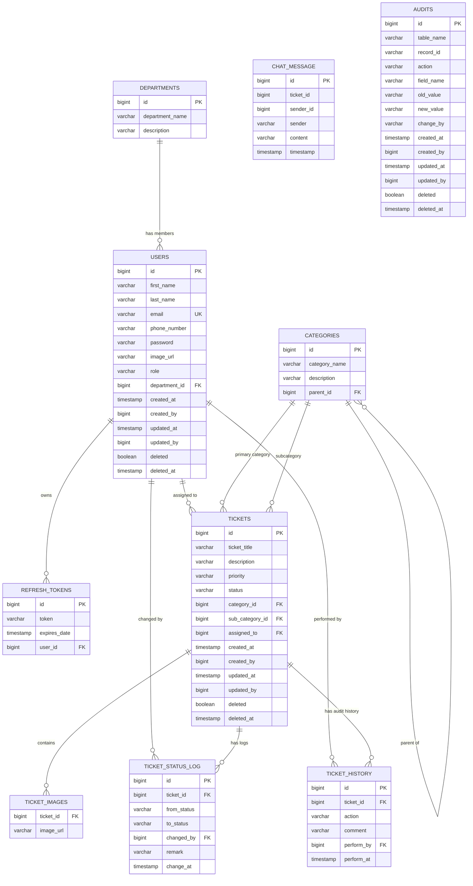

# Phase 4: Data Model & Entity Relationship Analysis

This document outlines the entity model, data constraints, DTO definitions, enumerations, auditing mechanisms, and soft-delete behaviors in the Spring Boot backend.

---

## 1. Entity-Relationship (ER) Diagram

---

## 2. Detailed Entity Catalog

### 2.1 `AuditableCustom` (Base MappedSuperclass)
- **Source**: [AuditableCustom.java](file:///D:/Course Wing/Final/fix/helpdesk/src/main/java/com/zaby/helpdesk/model/AuditableCustom.java)
- **Purpose**: Base class providing JPA auditing and soft delete state. Inherited by `User`, `Ticket`, and `Audit`.
- **Fields**:
  | Field | Type | Column Name | Annotations | Description |
  | :--- | :--- | :--- | :--- | :--- |
  | `createdAt` | LocalDateTime | `created_at` | `@CreatedDate`, `@JsonFormat("yyyy-MM-dd HH:mm:ss")` | Timestamp when record was created |
  | `createdBy` | Long | `created_by` | `@CreatedBy`, `nullable = true` | User ID of creator (from `AuditorAware`) |
  | `updatedAt` | LocalDateTime | `updated_at` | `@LastModifiedDate` | Timestamp of last modification |
  | `updatedBy` | Long | `updated_by` | `@LastModifiedBy` | User ID of modifier |
  | `deleted` | boolean | `deleted` | Default: `false` | Soft-delete flag |
  | `deleteAt` | LocalDateTime | `deleted_at` | None | Timestamp of soft-deletion (currently unused) |

### 2.2 `User` (`users`)
- **Source**: [User.java](file:///D:/Course Wing/Final/fix/helpdesk/src/main/java/com/zaby/helpdesk/model/User.java)
- **Inherits**: `AuditableCustom`
- **Fields**:
  | Field | Type | DB Column | Constraints | Notes |
  | :--- | :--- | :--- | :--- | :--- |
  | `id` | Long | `id` | PK, Identity | Auto-generated |
  | `firstName` | String | `first_name` | `length = 255` | Required |
  | `lastName` | String | `last_name` | `length = 255` | Required |
  | `email` | String | `email` | `length = 50, unique = true` | Login identifier |
  | `phoneNumber`| String | `phone_number` | `length = 50` | Optional |
  | `password` | String | `password` | `length = 255` | BCrypt encoded hash |
  | `imageUrl` | String | `image_url` | Text | Profile avatar URL |
  | `role` | Role | `role` | Enum string (`ADMIN`, `USER`, `TECHNICIAN`) | Security role |
  | `department` | Department | `department_id` | `@ManyToOne(cascade = CascadeType.MERGE)` | User's department |

### 2.3 `Department` (`departments`)
- **Source**: [Department.java](file:///D:/Course Wing/Final/fix/helpdesk/src/main/java/com/zaby/helpdesk/model/Department.java)
- **Fields**:
  | Field | Type | DB Column | Constraints | Notes |
  | :--- | :--- | :--- | :--- | :--- |
  | `id` | Long | `id` | PK, Identity | Auto-generated |
  | `name` | String | `department_name` | String | e.g., `"IT"`, `"HR"`, `"Finance"` |
  | `description`| String | `description` | String | Department details |

### 2.4 `Category` (`categories`)
- **Source**: [Category.java](file:///D:/Course Wing/Final/fix/helpdesk/src/main/java/com/zaby/helpdesk/model/Category.java)
- **Fields**:
  | Field | Type | DB Column | Constraints | Notes |
  | :--- | :--- | :--- | :--- | :--- |
  | `id` | Long | `id` | PK, Identity | Auto-generated |
  | `name` | String | `category_name` | `length = 255` | Category title |
  | `description`| String | `description` | `length = 255` | Description |
  | `parent` | Category | `parent_id` | `@ManyToOne(fetch = FetchType.LAZY)` | Parent category (null for root) |
  | `subCategories`| List<Category>| - | `@OneToMany(mappedBy = "parent", cascade = ALL, orphanRemoval = true)` | Nested subcategory tree |

### 2.5 `Ticket` (`tickets`)
- **Source**: [Ticket.java](file:///D:/Course Wing/Final/fix/helpdesk/src/main/java/com/zaby/helpdesk/model/Ticket.java)
- **Inherits**: `AuditableCustom`
- **Fields**:
  | Field | Type | DB Column | Constraints | Notes |
  | :--- | :--- | :--- | :--- | :--- |
  | `id` | Long | `id` | PK, Identity | Auto-generated |
  | `ticketTitle` | String | `ticket_title` | String | Brief summary |
  | `description` | String | `description` | `length = 255` | Incident details |
  | `priority` | Priority | `priority` | Enum string (`HIGH`, `MEDIUM`, `LOW`) | Urgency level |
  | `status` | Status | `status` | Enum string (`PENDING`, `IN_PROGRESS`, `COMPLETED`)| Lifecycle state |
  | `category` | Category | `category_id` | `@ManyToOne` | Parent category |
  | `subCategory` | Category | `sub_category_id` | `@ManyToOne` | Optional subcategory |
  | `assignedTo` | User | `assigned_to` | `@ManyToOne(fetch = FetchType.LAZY)` | Assigned technician |
  | `imageUrls` | List<String> | `ticket_images` | `@ElementCollection`, table `ticket_images` | S3/Supabase attachment URLs |
  | `ticketStatusLog`| List<TicketStatusLog>| - | `@OneToMany(mappedBy = "ticket", cascade = ALL)` | State progression history |
  | `ticketHistory`| List<TicketHistory> | - | `@OneToMany(mappedBy = "ticket", cascade = ALL)` | Action audit logs |

### 2.6 `TicketStatusLog` (`ticket_status_log`)
- **Source**: [TicketStatusLog.java](file:///D:/Course Wing/Final/fix/helpdesk/src/main/java/com/zaby/helpdesk/model/TicketStatusLog.java)
- **Fields**:
  | Field | Type | DB Column | Constraints | Notes |
  | :--- | :--- | :--- | :--- | :--- |
  | `id` | Long | `id` | PK, Identity | Auto-generated |
  | `ticket` | Ticket | `ticket_id` | `@ManyToOne`, `@JsonIgnore` | Parent ticket |
  | `fromStatus` | String | `from_status` | String | Prior status (null upon creation) |
  | `toStatus` | String | `to_status` | String | New status |
  | `changedBy` | User | `changed_by` | `@ManyToOne(fetch = FetchType.LAZY)` | Actor who triggered transition |
  | `remark` | String | `remark` | `length = 255` | Note attached to status transition |
  | `changedAt` | LocalDateTime | `change_at` | LocalDateTime | Timestamp of change |

### 2.7 `TicketHistory` (`ticket_history`)
- **Source**: [TicketHistory.java](file:///D:/Course Wing/Final/fix/helpdesk/src/main/java/com/zaby/helpdesk/model/TicketHistory.java)
- **Fields**:
  | Field | Type | DB Column | Constraints | Notes |
  | :--- | :--- | :--- | :--- | :--- |
  | `id` | Long | `id` | PK, Identity | Auto-generated |
  | `ticket` | Ticket | `ticket_id` | `@ManyToOne(fetch = FetchType.LAZY)` | Reference to ticket |
  | `action` | Action | `action` | Enum string (`CREATE`, `UPDATE`, `DELETE`, `ASSIGN`, `RESOLVE`) | Operation type |
  | `comment` | String | `comment` | `length = 1000` | Summary of modification |
  | `performedBy`| User | `perform_by` | `@ManyToOne(fetch = FetchType.LAZY)` | Acting user |
  | `performAt` | LocalDateTime | `perform_at` | LocalDateTime | Action timestamp |

### 2.8 `ChatMessage` (`chat_message`)
- **Source**: [ChatMessage.java](file:///D:/Course Wing/Final/fix/helpdesk/src/main/java/com/zaby/helpdesk/model/ChatMessage.java)
- **Fields**:
  | Field | Type | DB Column | Constraints | Notes |
  | :--- | :--- | :--- | :--- | :--- |
  | `id` | Long | `id` | PK, Identity | Auto-generated |
  | `ticketId` | Long | `ticket_id` | Unindexed bigint | FK to ticket (not a JPA relationship) |
  | `senderId` | Long | `sender_id` | bigint | FK to user (not a JPA relationship) |
  | `sender` | String | `sender` | String | Full name or handle of sender |
  | `content` | String | `content` | String | Message text |
  | `timestamp` | LocalDateTime | `timestamp` | LocalDateTime | Message timestamp |

### 2.9 `RefreshToken` (`refresh_token`)
- **Source**: [RefreshToken.java](file:///D:/Course Wing/Final/fix/helpdesk/src/main/java/com/zaby/helpdesk/model/RefreshToken.java)
- **Fields**:
  | Field | Type | DB Column | Constraints | Notes |
  | :--- | :--- | :--- | :--- | :--- |
  | `id` | Long | `id` | PK, Identity | Auto-generated |
  | `token` | String | `token` | `length = 2040` | UUID token string |
  | `expiresDate`| LocalDateTime | `expires_date` | LocalDateTime | Expiration timestamp (+7 days) |
  | `user` | User | `user_id` | `@ManyToOne(fetch = FetchType.LAZY)` | Associated account |

### 2.10 `Audit` (`audits` - Dormant Entity)
- **Source**: [Audit.java](file:///D:/Course Wing/Final/fix/helpdesk/src/main/java/com/zaby/helpdesk/model/Audit.java)
- **Status**: **Dormant**. Exists in entity model but has no repository or service writing to it.

---

## 3. Enumerations

| Enum Name | Source Citation | Allowed Values |
| :--- | :--- | :--- |
| **`Role`** | [Role.java](file:///D:/Course Wing/Final/fix/helpdesk/src/main/java/com/zaby/helpdesk/enumeration/Role.java) | `ADMIN`, `USER`, `TECHNICIAN` |
| **`Status`** | [Status.java](file:///D:/Course Wing/Final/fix/helpdesk/src/main/java/com/zaby/helpdesk/enumeration/Status.java) | `PENDING`, `IN_PROGRESS`, `COMPLETED` |
| **`Priority`** | [Priority.java](file:///D:/Course Wing/Final/fix/helpdesk/src/main/java/com/zaby/helpdesk/enumeration/Priority.java) | `HIGH`, `MEDIUM`, `LOW` |
| **`Action`** | [Action.java](file:///D:/Course Wing/Final/fix/helpdesk/src/main/java/com/zaby/helpdesk/enumeration/Action.java) | `CREATE`, `UPDATE`, `DELETE`, `ASSIGN`, `RESOLVE` |

---

## 4. DTO Inventory (Requests & Responses)

### 4.1 Request DTOs
All request models are Java records in package `com.zaby.helpdesk.dto.request`:
1. **`CategoryRequest`** (`String name, String description, Long parentId`)
2. **`DepartmentRequest`** (`String name, String description`)
3. **`LoginRequest`** (`String email, String password`)
4. **`RefreshTokenRequest`** (`String refreshToken`)
5. **`TicketRequest`** (`@NotBlank String ticketTitle, @NotBlank String description, @NotNull Priority priority, Long categoryId, Long subCategoryId, Long assignedTo, List<String> imageUrls`)
6. **`UpdateStatusRequest`** (`Status status, String remark`)
7. **`UserRequest`** (`String firstName, String lastName, String email, String phoneNumber, String password, String imageUrl, Role role, Long departmentId`)

### 4.2 Response DTOs
All response models are Java records in package `com.zaby.helpdesk.dto.response`:
1. **`AuthResponse`**: `email, message, firstName, lastName, departmentId, role, accessToken, refreshToken`
2. **`CategoryResponse`**: `id, name, description, parentId, List<CategoryResponse> subCategories`
3. **`DashboardStatsResponse`**: `totalTickets, pendingTickets, inProgressTickets, completedTickets, totalUsers`
4. **`DepartmentResponse`**: `id, name, description`
5. **`MonthlyChartResponse`**: `List<Long> received, List<Long> due` (12 monthly elements)
6. **`NotificationResponse`**: `id, image, title, subTitle, createdAt`
7. **`TicketHistoryResponse`**: `id, ticketId, ticketTitle, action, comment, performById, performByName, performAt`
8. **`TicketResponse`**: `id, ticketTitle, description, priority, status, categoryId, categoryName, subCategoryId, subCategoryName, assignedTo, assignedName, List<TicketStatusLogResponse> logs, createdBy, createdByName, createdAt, completedAt, List<String> imageUrls`
9. **`TicketStatusLogResponse`**: `id, ticketId, fromStatus, toStatus, changedById, changedByName, remark, changedAt`
10. **`UserResponse`**: `id, firstName, lastName, email, phoneNumber, imageUrl, role, departmentId, departmentName, createdAt, updatedAt, ticketsCreated, ticketsAssigned, ticketsResolved, ticketsOpen`

---

## 5. Auditing, Soft Delete & Versioning Behavior

1. **JPA Auditing**:
   - Configured via [AuditingConfig.java](file:///D:/Course Wing/Final/fix/helpdesk/src/main/java/com/zaby/helpdesk/config/AuditingConfig.java#L14) with `@EnableJpaAuditing(auditorAwareRef = "auditorProvider")`.
   - `AuditorAware<Long>` resolves `SecurityContextHolder.getContext().getAuthentication()` and extracts `CustomUserDetails.getUser().getId()`.
   - Automatically populates `createdBy`, `createdAt`, `updatedBy`, and `updatedAt` for entities extending `AuditableCustom`.
2. **Soft Delete Implementation**:
   - Maintained manually on `Ticket` and `User` using the `boolean deleted` flag.
   - **No Hibernate `@SQLRestriction` / `@Where` annotation is present**. Every repository method must explicitly include `...AndDeletedFalse` (e.g. `findByIdAndDeletedFalse`, `findAllByDeletedFalse`).
   - If a developer executes `ticketRepository.findById(id)` without `AndDeletedFalse`, soft-deleted tickets will be returned.
   - The field `deleteAt` defined on `AuditableCustom` is never populated by `TicketServiceImpl` or `UserServiceImpl`.
3. **Optimistic Locking / Versioning**:
   - **No `@Version` field** is defined on any entity. Concurrent edits to tickets by multiple technicians will overwrite each other without conflict detection (last-write-wins).
