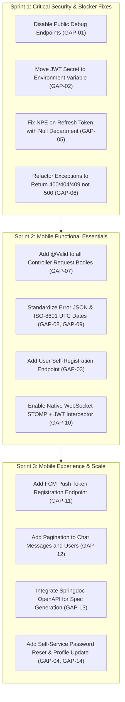

# Phase 6: Mobile Readiness Gap Analysis & Prioritized Remediation Plan

This document identifies all architectural, security, functional, and data contract gaps between the current Spring Boot backend and the requirements of a production-ready Flutter mobile application. Gaps are categorized by severity: **Blocker**, **Important**, and **Nice to have**, followed by a prioritized remediation roadmap.

---

## 1. Executive Gap Matrix

| ID | Category | Issue Description | Severity | Mobile App Impact |
| :--- | :--- | :--- | :--- | :--- |
| **GAP-01** | **Security** | Debug endpoints (`/api/v1/debug/**`) exposed publicly without auth | **BLOCKER** | High security risk; production data leak |
| **GAP-02** | **Security** | Hardcoded JWT secret key in source code | **BLOCKER** | Critical vulnerability; token forgery possible |
| **GAP-03** | **Auth / Lifecycle** | Missing user registration / self-signup endpoint | **BLOCKER** | Mobile users cannot sign up without admin intervention |
| **GAP-04** | **Auth / Lifecycle** | Missing password reset / forgot password flow | **BLOCKER** | Locked out mobile users have no recovery path |
| **GAP-05** | **Reliability** | `NullPointerException` on token refresh when department is null | **BLOCKER** | Permanent user lockout upon token expiration |
| **GAP-06** | **Error Handling** | Services throw `RuntimeException`, causing false 500 errors | **BLOCKER** | 404/409 errors masked as 500 Internal Server Error |
| **GAP-07** | **Validation** | Missing `@Valid` annotations on all controllers | **IMPORTANT** | Invalid inputs bypass bean validation silently |
| **GAP-08** | **Data Contract** | Inconsistent error response JSON formats | **IMPORTANT** | Complex, fragile JSON parsing in Flutter Dio interceptors |
| **GAP-09** | **Data Contract** | Inconsistent date/time formatting & missing UTC offset | **IMPORTANT** | Mobile date parsing crashes or timezone skew |
| **GAP-10** | **Real-Time** | WebSocket unauthenticated & SockJS framing complications | **IMPORTANT** | Mobile STOMP client handshake issues; unauthorized snooping |
| **GAP-11** | **Notifications** | Absence of push notification device token registration | **IMPORTANT** | No native mobile push notifications when app is backgrounded |
| **GAP-12** | **Performance** | Unpaginated endpoints for Users, Chat Messages, and History | **IMPORTANT** | Network bandwidth waste and mobile UI lag |
| **GAP-13** | **Tooling** | Absence of OpenAPI / Swagger specification | **IMPORTANT** | Manual model synchronization, prone to client typos |
| **GAP-14** | **Features** | Regular users cannot change own password or profile avatar | **NICE TO HAVE**| Reduced self-service UX on mobile |
| **GAP-15** | **Architecture** | Manual soft-delete queries instead of `@SQLRestriction` | **NICE TO HAVE**| Accidental leaks of deleted tickets if repo method changes |
| **GAP-16** | **Concurrency** | Missing `@Version` optimistic locking on tickets | **NICE TO HAVE**| Concurrent technician edits overwrite each other |

---

## 2. In-Depth Analysis of Critical Gaps

### 2.1 GAP-01: Public Debug Endpoints Exposing Database (BLOCKER)
- **File**: [SecurityConfig.java](file:///D:/Course Wing/Final/fix/helpdesk/src/main/java/com/zaby/helpdesk/security/SecurityConfig.java#L46) & [DebugController.java](file:///D:/Course Wing/Final/fix/helpdesk/src/main/java/com/zaby/helpdesk/controller/DebugController.java)
- **Finding**: `.requestMatchers("/api/v1/debug/**").permitAll()` allows anyone on the internet to query `GET /api/v1/debug/tickets` and `GET /api/v1/debug/mytickets` without an `Authorization` header.
- **Remediation**: Remove `DebugController.java` before deploying to production or restrict it to `hasRole('ADMIN')` and disable it in the production profile.

### 2.2 GAP-02: Hardcoded JWT Secret Key in Source Code (BLOCKER)
- **File**: [JwtService.java](file:///D:/Course Wing/Final/fix/helpdesk/src/main/java/com/zaby/helpdesk/security/JwtService.java#L15)
- **Finding**: `private final String SECRET = "mysecretkeymysecretkeymysecretkey123";` is committed in plaintext.
- **Remediation**:
  ```java
  @Value("${jwt.secret}")
  private String secret;
  ```
  Inject secret via environment variable (`JWT_SECRET`) with a minimum length of 256 bits (32 bytes).

### 2.3 GAP-03 & GAP-04: Missing Self-Service Account Lifecycle (BLOCKER)
- **File**: [AuthController.java](file:///D:/Course Wing/Final/fix/helpdesk/src/main/java/com/zaby/helpdesk/controller/AuthController.java)
- **Finding**: Only `POST /login`, `POST /refresh`, and `POST /logout` exist. Mobile apps expect:
  1. `POST /api/v1/auth/register` (creates user with default role `USER`).
  2. `POST /api/v1/auth/forgot-password` (sends reset OTP/link).
  3. `POST /api/v1/auth/reset-password` (verifies OTP and sets new password).
- **Remediation**: Implement public registration and password recovery endpoints in `AuthController`.

### 2.4 GAP-05: NullPointerException in Token Refresh Flow (BLOCKER)
- **File**: [AuthController.java](file:///D:/Course Wing/Final/fix/helpdesk/src/main/java/com/zaby/helpdesk/controller/AuthController.java#L52)
- **Finding**:
  ```java
  tokenEntity.getUser().getDepartment().getId()
  ```
  If a user has no assigned department (`department == null`), refreshing their access token throws an unhandled `NullPointerException`. The client receives HTTP 500 and is forced to log in again.
- **Remediation**: Replace with safe navigation:
  ```java
  tokenEntity.getUser().getDepartment() != null ? tokenEntity.getUser().getDepartment().getId() : null
  ```

### 2.5 GAP-06: Service RuntimeExceptions Masked as Generic 500 (BLOCKER)
- **Files**: [UserServiceImpl.java](file:///D:/Course Wing/Final/fix/helpdesk/src/main/java/com/zaby/helpdesk/service/impl/UserServiceImpl.java#L33), [DepartmentServiceImpl.java](file:///D:/Course Wing/Final/fix/helpdesk/src/main/java/com/zaby/helpdesk/service/impl/DepartmentServiceImpl.java#L32), [GlobalExceptionHandler.java](file:///D:/Course Wing/Final/fix/helpdesk/src/main/java/com/zaby/helpdesk/exception/GlobalExceptionHandler.java)
- **Finding**: When an entity is missing or email is duplicated, services throw `RuntimeException`. [GlobalExceptionHandler.java](file:///D:/Course Wing/Final/fix/helpdesk/src/main/java/com/zaby/helpdesk/exception/GlobalExceptionHandler.java) intercepts this with `handleGenericException`, returning `500 INTERNAL_SERVER_ERROR`.
- **Remediation**:
  - Replace `RuntimeException("User not found")` with `ResourceNotFoundException("User not found")` (HTTP 404).
  - Replace `RuntimeException("Email already exists")` with `BusinessException("Email already exists")` (HTTP 400) or handle `DataIntegrityViolationException` (HTTP 409).
  - Add handlers in `GlobalExceptionHandler` for `IllegalArgumentException` and `IllegalStateException` returning HTTP 400.

### 2.6 GAP-07: Missing `@Valid` Annotations on Controllers (IMPORTANT)
- **Files**: [TicketController.java](file:///D:/Course Wing/Final/fix/helpdesk/src/main/java/com/zaby/helpdesk/controller/TicketController.java#L24), [UserController.java](file:///D:/Course Wing/Final/fix/helpdesk/src/main/java/com/zaby/helpdesk/controller/UserController.java#L25)
- **Finding**: Controller methods use `@RequestBody TicketRequest ticketRequest` without `@Valid`. Jakarta validation constraints (e.g. `@NotBlank String ticketTitle`, `@NotNull Priority priority`) are completely ignored! A client can submit empty strings or null titles without validation rejection.
- **Remediation**: Add `@Valid` to all `@RequestBody` controller arguments.

### 2.7 GAP-08 & GAP-09: Data Format Inconsistencies (IMPORTANT)
- **Error Consistency**: Mobile HTTP interceptors need a single standard response:
  ```json
  {
    "status": 400,
    "message": "Validation failed",
    "timestamp": "2026-10-22T13:45:00Z",
    "errors": { "field": "message" }
  }
  ```
- **Date/Time Uniformity**: Standardize all date fields to ISO-8601 UTC format (`yyyy-MM-dd'T'HH:mm:ss'Z'`). Eliminate formatted strings like `"yyyy-MM-dd HH:mm:ss"`.

### 2.8 GAP-10: WebSocket STOMP Handshake & Security (IMPORTANT)
- **File**: [WebSocketConfig.java](file:///D:/Course Wing/Final/fix/helpdesk/src/main/java/com/zaby/helpdesk/config/WebSocketConfig.java)
- **Finding**:
  1. The endpoint includes `.withSockJS()`. Standard Flutter STOMP packages (like `stomp_dart_client`) connect via native WebSocket (`ws://host:8080/ws-chat/websocket`), which can fail if the server expects SockJS transport framing.
  2. The endpoint `/ws-chat/**` has `permitAll()` with no STOMP `ChannelInterceptor` checking JWT Bearer tokens during the STOMP `CONNECT` frame.
- **Remediation**:
  - Register a raw WebSocket STOMP endpoint alongside SockJS:
    ```java
    registry.addEndpoint("/ws-chat").setAllowedOriginPatterns("*");
    registry.addEndpoint("/ws-chat").setAllowedOriginPatterns("*").withSockJS();
    ```
  - Implement a `ChannelInterceptor` in WebSocket configuration that validates the `Authorization: Bearer <token>` STOMP connect header.

### 2.9 GAP-11: Missing Device Push Token Registration (IMPORTANT)
- **Finding**: Support tickets require asynchronous notifications when tickets are assigned, status updates occur, or replies are posted. Currently, notifications are only delivered via polling `GET /api/v1/tickets/activity` or active WebSocket subscriptions.
- **Remediation**: Add an endpoint `POST /api/v1/notifications/device-token` accepting `{ "token": "fcm_token_...", "platform": "ANDROID|IOS" }` and integrate Firebase Cloud Messaging (FCM).

---

## 3. Prioritized Fix Roadmap for Backend Team


